**English** | [Türkçe](README.tr.md)

# reference-to-3d — a Claude Code skill

Turn pictures into 3D models in Blender that look **exactly like the picture**.

Instead of modelling "something like it" by eye, this skill makes Claude use the picture itself: its outlines for the
shape, its pixels for the surface, and numbers (not impressions) to check the result against the picture.

| You give | You get |
|---|---|
| A turnaround sheet or separate front / side / rear / top views (photos or concept art) | A model fitted to the outlines, textured with the views' own pixels |
| One picture of an interior seen from one place (a car's cockpit, a game camera) | An inside that is pixel-exact from that place |
| One photo or render of a room | A room you can **walk through**: the camera solved from the photo, props in 3D, the unseen sides built from the photo's own repeating parts |
| Several ordinary phone photos of a real room, taken from different places (an office, a flat) | The whole room and every camera solved together, the corridor outside, a door that opens, every object modelled from a photo of it (books leaning as on the shelf, a rotary phone, a printer), and a walk-through viewer in one HTML file |
| One ordinary photo of a product whose size is known (a laptop, a phone, a chair) | The product built to its real dimensions, the photo rectified onto each surface |
| One photo of a turned object (a pot, a bottle, a vase, a mug) | Its profile turned round the axis, side handles as solid parts, a cup's inside, the photo wrapped all round, then real materials (steel, plastic, porcelain) instead of the photo's light |
| Two ordinary photos of a product whose size you do not know, front and side (a desk phone, a printer, a kettle) | Both cameras and one body solved together from the photos' edges, every part shaped from what a photo shows (the handset's arc, steps, where the cord leaves), then real materials with the photos' printing kept |
| One photo of a container with things in it (a pen holder with pens and scissors, a basket, a jar) | The container as above, its contents placed from the photo and standing on its base, a wire-mesh wall you can see through, the contents behind the mesh textured from what the photo shows between the wires |
| One product photo of a furniture set with things on it, in its room (a table, a bench, stools, cups, a plate, candles, a plant) | Every piece fitted to the photo (seats to their cushions' outlines, splayed legs, each object standing where it stands and on what it stands), materials taken from the photo's own pixels, the room around it, and the light fitted to the photo's contrast as well as its colours |
| One photo of a vehicle of a known type (an airliner, a car, a ship), even an AI image | The camera solved with the type's real dimensions as priors, every part (wings, winglets, tail cone, fin, engines, gear) fitted to the photo's outline, the photo unwrapped onto each part and mirrored to the side it does not show, then real materials, the ground and the sky taken from the photo, and the sun solved from the shadow |
| Several frames of a drone video taken round a landmark (a tower on an island, a castle, a lighthouse, a round tower) | Every frame's camera solved and refined on the frames' edges, the building and its island built to scale (from its doors or a published dimension), the waterline measured from the frames, the photos projected with their light divided out, the side no frame shows synthesised from the seen stones, then real materials, armour stones, the sun from a shadow |

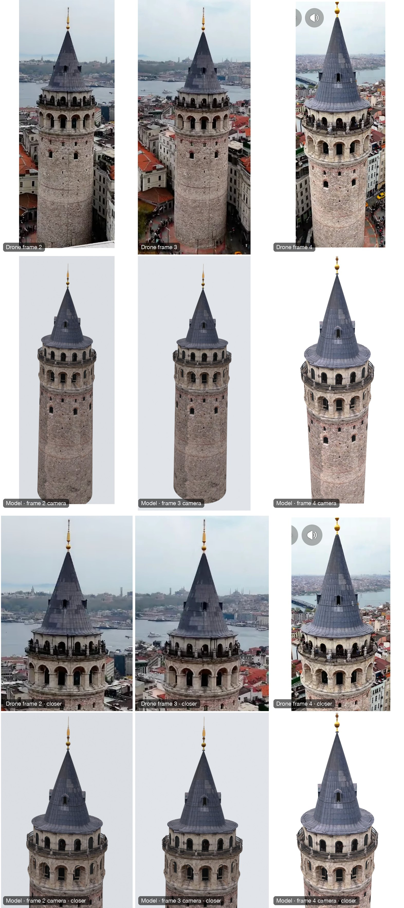

*The Galata Tower (Istanbul) from four screenshots of drone videos, 250-456 px wide, no EXIF. Every pair is one
view twice: a present-day frame, and below it the model in real materials (Blender, Cycles) rendered through that
frame's solved camera with the same crop; first the whole tower, then the upper tower closer. All three frames look
at the tower from the Golden Horn's side. The profile and every camera were solved
together from the finial, the rings' extremes and fronts and the tracked silhouettes; the frames' angles round the
tower from the shaft's windows as shared points; the scale from the published 16.45 m base, which puts the cone's
apex 61.9 m above the ground (published 62.59 m). The fourth frame shows the tower before its 2020 restoration and
was used for the unchanged shaft only. The unseen side is synthesised from the seen stones (full-height strips joined
by minimum-error cuts, windows kept apart; whole bays for the 14 arches), after the first delivery's rotated copies
read as patches. Mean colour difference from the frames' cameras 4.8/255 (3.9 for the photo-projected version). Not
identical: the people on the balcony are not modelled, two frames had a soft sun the delivered overcast light lacks,
the unseen side's windows are where the synthesis put them. How:
[`examples/galata-tower-drone-frames/`](examples/galata-tower-drone-frames/).*

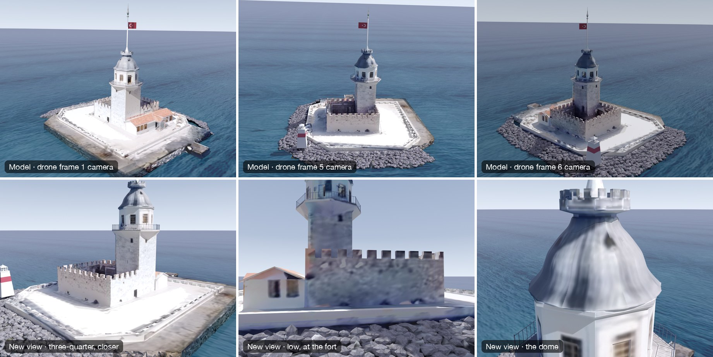

*The Maiden's Tower (Istanbul) from six screenshots of a drone video taken all round it (each cropped and scaled
differently, no EXIF). Each frame is above the model in real materials (Blender, Cycles) from that frame's solved
camera, same crop: frames 1-3 in the first row, 4-6 in the third. The six cameras were solved
together from hand-read points, then each refined on the frames' edges with those points held; the scale comes from
two doors (2.1 m), the waterline from the six masks intersected on horizontal planes. The frames' pixels are
projected through a depth test with the light divided out; the sunlit stone the frames clipped to white takes the
same stone's pattern from its shaded side, the rocks are armour stones textured from the frames' rock band, the
beacon's stripe is rebuilt level at its measured height. Silhouette IoU 0.887 over the six frames, mean colour
difference 10/255. Not identical yet: the annex's windows are texture, the waterline's foam is missing, one back-lit
frame stays darker in shade (its tone curve). The scale had first been guessed from people and was 24 % off
(`references/drone-frames-landmark.md`). How:
[`examples/maiden-tower-drone-frames/`](examples/maiden-tower-drone-frames/).*

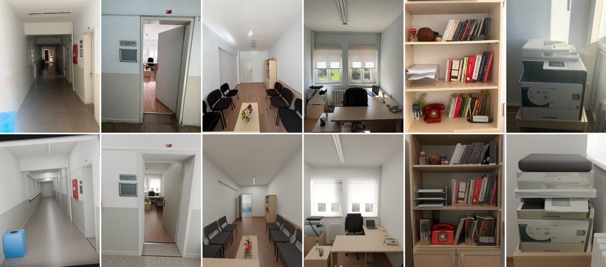

*Top, six of the fifteen phone photos (no EXIF, 1x and 0.5x lenses): the corridor, the door from the corridor, the
room from the window and from the door, the bookcase, the printer. Bottom, the model from the same solved cameras
(Blender, Cycles). One parametric room (2.55 x 5.38 x 2.81 m) and all cameras were solved together from hand-read
corners and furniture seen in several photos; the corridor, the door leaf on its hinge, the bookcase with each book
as its own leaning volume, the rotary phone, the desk phone, the laptop and the printer are each modelled from a
photo of them, and the whole thing walks in a browser (WASD, the door opens with E). The user's corrections over five
rounds are written up in `references/multi-photo-room.md`. How:
[`examples/office-room-multiphoto/`](examples/office-room-multiphoto/).*

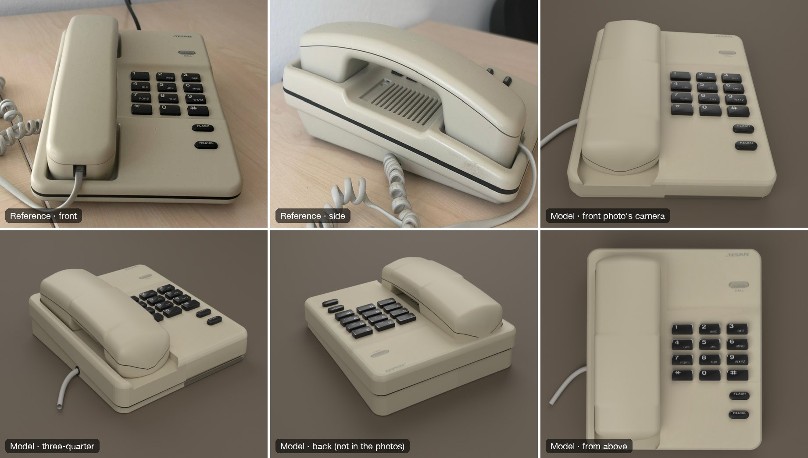

*Top left and middle, the references: two phone photos of a cream desk phone, from the front and from the handset's
side; no size, no EXIF. The rest is the model in real materials (cream ABS with the photo's printing kept, glossy
black keys with their labels; Blender, Cycles): from the front photo's camera, then from sides neither photo shows.
Both cameras and one body were solved together from the photos' straight edges and the keys and buttons both photos
see (the side photo fixed what the front alone could not: a 23/31 mm body, not a 16/47 mm wedge); the handset's arc,
the base's step and the cord's exit read off the side photo. From the front photo's camera the photo-textured
version matches to 6.7/255 (median 0.3); the real-material front face is within 1 %. How:
[`examples/desk-phone-two-photos/`](examples/desk-phone-two-photos/).*

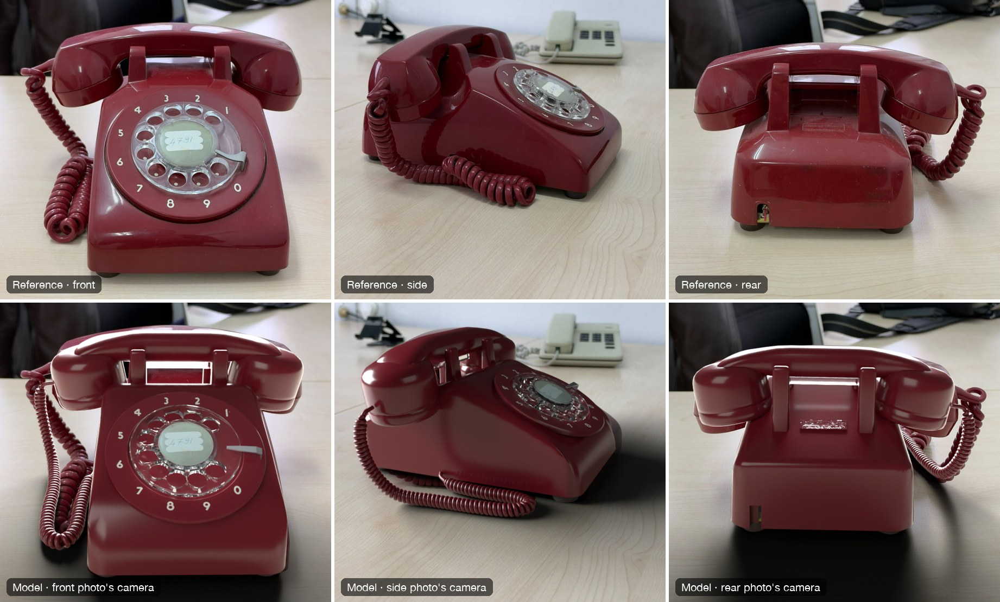

*Top row, the references: three phone photos of a red rotary telephone, turned between the shots; no EXIF. Bottom
row, the model in real materials (Blender, Cycles) from each photo's solved camera, set over the photo. The scale
is the finger wheel's 76.2 mm; the cameras come from the dial's circles and digits, the body is a height field with
rolled edges and the handset a bar with two cups, both fitted to the silhouettes part by part (IoU 0.89-0.97 body,
0.87-0.91 handset); the digits and the number card are the front photo's pixels rectified onto the dial. The lesson
that cost the most: the red colour masks had cut every lit face, and fits to them invented a handset that had
"moved" and a "wrong" camera (`references/three-photo-object.md`). Not identical yet: the handset's ends and the
room's reflections still differ. How:
[`examples/rotary-phone-three-photos/`](examples/rotary-phone-three-photos/).*

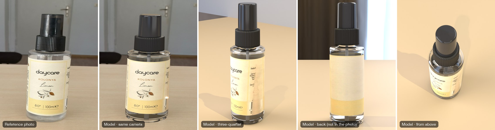

*Left, the reference: one phone photo of a 100 ml cologne spray bottle on a desk. The rest is the model in real
materials (clear PET with the liquid inside, the label as paper printed on it, black ribbed collar, smoked cap;
Blender, Cycles): from the photo's camera, then from sides the photo never shows. The camera was solved from the
body's straight edges and the circles of the collar, shoulder and base (the photo turned out to be a crop from a
level camera), the label rectified round the cylinder with the photo's shading divided out, the crooked sprayer head
set straight; seen from the photo's camera the photo-textured version matches to 0.966 (IoU) and 2.3/255, and the
real-material version's label, cap and collar are within 5 levels of the photo. How:
[`examples/cologne-bottle-revolved/`](examples/cologne-bottle-revolved/).*

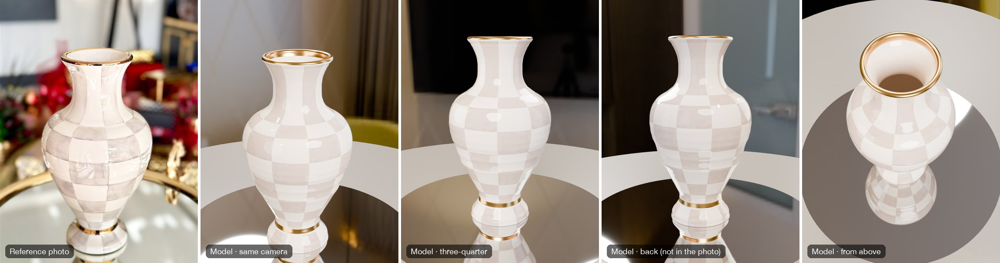

*Left, the reference: one 600 x 900 product photo of a hand-painted checkered porcelain vase with a gold rim and a
gold band, on a mirror tray in front of red flowers. The rest is the model in real materials (glazed porcelain, gold
leaf as metal; Blender, Cycles): from the photo's camera, then from sides the photo never shows. The camera was
solved from the rim, the gold band and the foot together; the photo unwrapped onto the vase showed ten straight
columns of squares, and the pattern was rebuilt all round from them without the photo's light and reflections. Seen
from the photo's camera the outline matches to 0.988 (IoU) and the photo-textured body to 1.0/255; the user's two
corrections (a mouth too narrow, colours too dull) are in the example's README. How:
[`examples/vase-checker-revolved/`](examples/vase-checker-revolved/).*

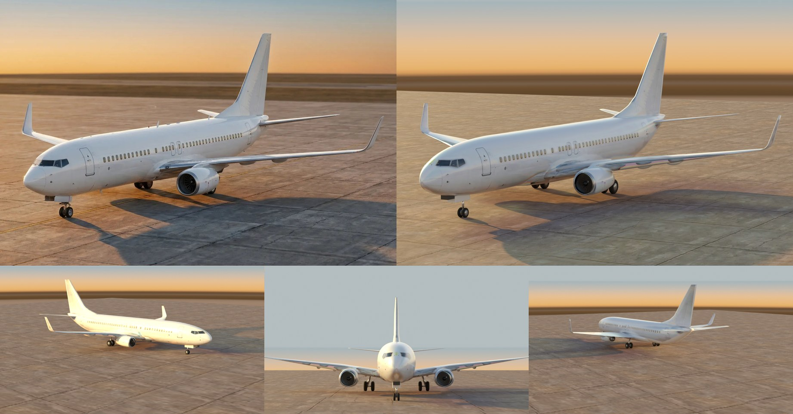

*Top left, the reference: one 1770 x 1187 picture (most likely AI) of a white Boeing 737-800 with blended winglets on
a concrete apron at sunset. Top right and below, the model in real materials (Blender, Cycles): from the picture's
camera, then from the right, the front and behind, which the picture never shows. The camera was solved from the
wingtips, the stabiliser and fin tips, the wheels' ground contacts and the fuselage's outline, with the type's
dimensions as priors; then about 40 shape parameters (wing, winglets, nose, tail cone, fin, stabiliser) were fitted to the
picture's silhouette by rasterising the model in numpy (edges within 1-4 px). The picture was unwrapped onto every
part through a depth test and mirrored onto the unseen side; the concrete, the sky and the sun's direction (from the
plane's shadow) come from the picture. From its camera the photo-textured version differs by 3.0/255 and the
real-material one by 9.0/255; what is left (the stabiliser's and wings' tops) is the picture's own light, which no
single sun matches, measured in the example's README. How:
[`examples/airliner-single-photo/`](examples/airliner-single-photo/).*

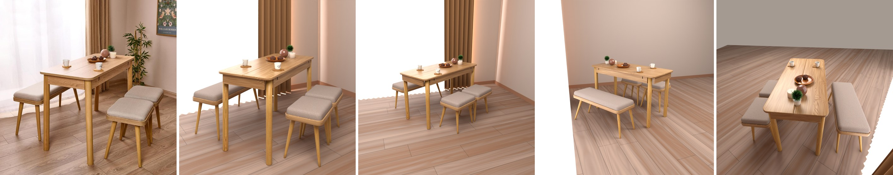

*Left, the reference: one 1000 x 1000 product photo of a flip-top oak dining table with a bench and two stools, two
cups on coasters, a wooden bowl with two muffins, a sphere candle, a pillar candle and a small plant, in a room with a
sheer-curtained window. The rest is the model (Blender, Cycles): from the photo's camera, then from sides the photo
never shows. The camera was solved level with its optical centre shifted (a corrected product shot) from the table
top's edges and the legs' feet; each seat is fitted to its cushion's outline, every object is placed by where it
touches the table and on what it stands. Every material comes from the photo's own pixels (the oak's palette, band
spacing and contrast from the aprons, the legs unrolled, the linen from the cushions), the room is modelled from the
photo, and the light is fitted to the photo's contrast as well as its colours: regions within 10/255, furniture
contrast 40 against the photo's 49 (from 25 before). The user's corrections, and the rule they led to (materials only
from the reference, compare until nothing differs), are in `references/single-photo-scene.md`. How:
[`examples/dining-set-single-photo/`](examples/dining-set-single-photo/).*

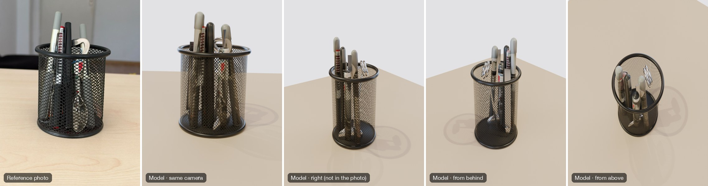

*Left, the reference: one phone photo of a mesh pen holder on a desk. The rest is the model in real materials
(black painted wire, steel, the pens' own printing; Blender, Cycles): from the photo's camera, then from sides the
photo never shows. The camera was solved from the rim's and base's circles and the wall's edges, the mesh's cell
pitch measured on the photo unwrapped onto the cylinder, each item placed where its foot meets the base; seen from
the photo's camera the holder's outline matches to 0.988 (IoU) and the pens above the rim to 3.7/255. How:
[`examples/pen-holder-mesh/`](examples/pen-holder-mesh/).*

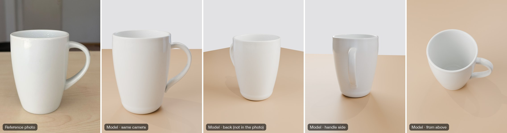

*Left, the reference: one ordinary phone photo of a mug on a desk. The rest is the model, in real porcelain
(Blender, Cycles): from the photo's own camera, then from sides the photo never shows. The camera was solved from the
rim's and base's outlines, the profile turned round the axis, the handle swept along its outline; seen from the
photo's camera the outline matches to 0.982 (IoU) and the photo-textured version's colours to 1.4/255. How:
[`examples/mug-revolved/`](examples/mug-revolved/).*

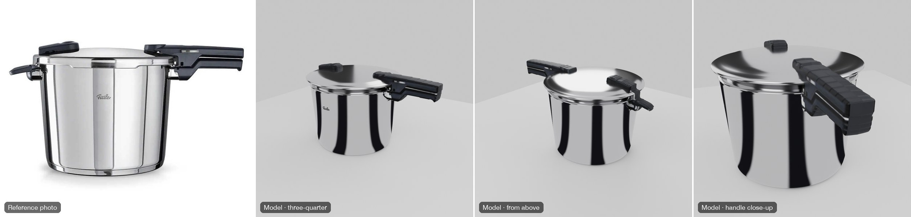

*Left, the reference: one side-on product photo. The rest is the model: the profile turned round the axis, the
handles as solid parts, then real polished steel and plastic (Blender, Cycles). The views from above and behind are
not in the photo. How:
[`examples/pressure-cooker-revolved/`](examples/pressure-cooker-revolved/).*

Results are saved as a **.blend** file (textures packed inside) and, if you want, a **glTF/GLB** for game engines
(Unity, Unreal, Godot, three.js), with moving parts such as wheels and doors as separate meshes.

---

## 1. What you need

| | |
|---|---|
| **Claude Code** | CLI, desktop app or IDE extension — [claude.com/claude-code](https://claude.com/claude-code) |
| **Blender** | 4.2 or newer (tested with 5.2) — [blender.org](https://www.blender.org/download/) |
| **uv** | Runs the Python scripts and installs their packages (numpy, OpenCV, …) on the fly — [docs.astral.sh/uv](https://docs.astral.sh/uv/getting-started/installation/) |

Install uv with one line:

```bash
curl -LsSf https://astral.sh/uv/install.sh | sh
```

On Windows (PowerShell):

```powershell
powershell -ExecutionPolicy ByPass -c "irm https://astral.sh/uv/install.ps1 | iex"
```

You do **not** need to install Python packages yourself; each script states its packages and `uv` fetches them.

## 2. Install the skill into Claude Code

A skill is just a folder with a `SKILL.md` file in it. Claude Code finds skills in two places:

| Where | Available in | Use it when |
|---|---|---|
| `~/.claude/skills/reference-to-3d/` | **all** your projects | you want it everywhere (recommended) |
| `<your-project>/.claude/skills/reference-to-3d/` | that project only | you want to share it with a team through the project's repository |

### Option A — with git (recommended)

macOS / Linux:

```bash
git clone https://github.com/asimsinan/reference-to-3d.git ~/.claude/skills/reference-to-3d
```

Windows (PowerShell):

```powershell
git clone https://github.com/asimsinan/reference-to-3d.git "$env:USERPROFILE\.claude\skills\reference-to-3d"
```

### Option B — without git

1. On GitHub, click **Code → Download ZIP**.
2. Unzip it.
3. Rename the folder to `reference-to-3d` and move it into `~/.claude/skills/` (Windows: `%USERPROFILE%\.claude\skills\`).

Either way, the result must be: `~/.claude/skills/reference-to-3d/SKILL.md` (the `SKILL.md` directly inside, not one
folder deeper).

### Check that it is installed

Start a **new** Claude Code session (skills are read at start-up), then type `/` — `reference-to-3d` should appear in
the list. You can also ask Claude: *"Which skills do you have?"*

### Tell Claude where Blender is (only if it is not in the default place)

The skill assumes Blender at `/Applications/Blender.app` on macOS. On Linux (`blender` on the PATH) and Windows, or
for a different location, just say it once in the chat, or add one line to your project's `CLAUDE.md`, for example:

```
Blender is at C:\Program Files\Blender Foundation\Blender 5.2\blender.exe
```

## 3. Use it

1. Put your picture(s) in your project folder, or paste/drag the image into the Claude Code chat.
2. Ask for what you want. There are two ways:
   - **Type the command:** `/reference-to-3d model the room in the picture`
   - **Or just ask normally.** Claude loads the skill by itself when the request fits, for example:
     - *"Make a 3D model of this car from these four views."*
     - *"Model the room in this picture — I want to walk around inside it."*
     - *"Build this laptop in 3D from the photo, it is a MacBook Pro 14."*
     - *"Model the pressure cooker in the attached photo."*
     - *"Model the mug in this photo, then make it real porcelain."*
     - *"Model the pen holder in this photo with everything in it."*
     - *"Model the cologne bottle in this photo."*
     - *"Model this desk phone — here is a photo from the front and one from the side."*
     - *"Export it as a GLB for Unity, with the wheels as separate parts."*

### What Claude will do

1. **Read the picture**: name the views, solve the camera, find one real size (it may ask you, e.g. "how tall is the door?").
2. **Build the shape**: fitted to the outlines, or measured through the solved camera.
3. **Put the picture's own pixels on it**.
4. **Measure** the result against the picture, view by view (outline overlap and colour difference in numbers), and
   show you a **side-by-side comparison** (picture left, model right).
5. **Fix** what you point at, one view at a time.
6. **Save** the `.blend` (it opens ready to look at) and, if asked, a GLB.

### Tips for good results

- **Give one real size** if you know it (a door is 2.0 m, the van is 1.9 m tall). Everything else follows from it.
- **Say where the model will be used**: a still render, a game engine, or walking through it.
- **Look at the comparison sheets and say what is different**; that is how you get from "close" to "identical".
- **Image-generation credits** (for filling sides no picture shows) are only spent after you approve; a free option
  that builds those sides from the picture's own repeating parts is always offered first.

### Limits to keep in mind

- The picture's lighting and reflections are baked into the texture; they do not change with your scene's lights.
- Surfaces that no picture shows are reasonable guesses, not the real thing; Claude says which ones.
- From one picture of a room, the result is exact from that picture's camera; walking around shows repeated pieces
  (the same window bay, the same machine) on a close look.

## 4. What is inside

```
reference-to-3d/
├── SKILL.md                     the instructions Claude follows (start here if you want to read how it works)
├── scripts/                     tools Claude runs (each has its usage in its header)
│   ├── split_sheet.py           turnaround sheet → named views and masks
│   ├── hull.py, loft.py         shape from the outlines (any object / long objects)
│   ├── textures.py, project.py  the views' pixels onto the model; renders, .blend, GLB export (Blender)
│   ├── compare.py               outline overlap and colour difference per view, comparison sheets
│   ├── solve_camera_vp.py       a room photo's camera from its lines (focal length, tilt, scale)
│   ├── rectify_plane.py         one wall/floor of a room straightened out of the photo
│   ├── shot_ui.py               screenshots a .blend as it opens, to check what you will see
│   └── quilt.py                 the side no picture shows, synthesised seamlessly from the seen part (a tower's back)
├── docs/showcase/               the images shown in this README
├── references/                  detailed guides Claude reads when a case needs them
│   ├── single-view-interior.md  one picture of an inside; rooms made walkable
│   ├── single-photo-object.md   one photo of a product of known size
│   ├── single-photo-revolved.md one photo of a turned object (pot, bottle, vase, mug)
│   ├── single-photo-container.md one photo of a container with things in it (a pen holder); see-through mesh walls
│   ├── two-photo-object.md      two photos (front, side) of a product of unknown size (a desk phone)
│   ├── three-photo-object.md    three photos of a curved product of a known type (a rotary phone)
│   ├── drone-frames-landmark.md several drone-video frames of a landmark (a tower on an island, a round tower)
│   ├── multi-photo-room.md      a real room from many phone photos, walkable with the corridor and a door
│   ├── single-photo-scene.md    one product photo of a furniture set with things on it, and its room
│   ├── single-photo-vehicle.md  one photo of a vehicle of a known type (an airliner)
│   ├── game-export.md           names, pivots and settings for game engines
│   └── pitfalls.md              what went wrong before and why
└── examples/                    fourteen complete worked examples with their scripts
    ├── airliner-single-photo/   a 737 airliner on an apron from one picture
    ├── laptop-single-photo/     a laptop from one photo
    ├── pressure-cooker-revolved/ a pressure cooker from one product photo
    ├── mug-revolved/            a porcelain mug from one phone photo
    ├── cologne-bottle-revolved/ a clear cologne spray bottle from one cropped phone photo
    ├── vase-checker-revolved/   a hand-painted checkered vase from one product photo
    ├── dining-set-single-photo/ a dining set with tabletop objects and its room from one product photo
    ├── pen-holder-mesh/         a wire-mesh pen holder with its contents from one phone photo
    ├── desk-phone-two-photos/   a corded desk phone from a front and a side phone photo
    ├── rotary-phone-three-photos/ a red rotary desk phone from front, side and rear phone photos
    ├── maiden-tower-drone-frames/ the Maiden's Tower from six drone-video frames
    ├── galata-tower-drone-frames/ the Galata Tower from four drone-video frames
    ├── office-room-multiphoto/  a walkable office and corridor from fifteen phone photos
    └── laundromat-room/         a walkable laundromat from one render
```

You do not need to run anything in `scripts/` or `examples/` yourself — Claude does. If you want to, each example's
`README.md` lists its commands in order.

## 5. Update

If you installed with git:

```bash
cd ~/.claude/skills/reference-to-3d && git pull
```

Start a new Claude Code session afterwards.

## 6. Troubleshooting

| Problem | Fix |
|---|---|
| `/reference-to-3d` does not appear | Check that `SKILL.md` is at `~/.claude/skills/reference-to-3d/SKILL.md`, then start a new session. |
| "Blender not found" | Tell Claude the full path to Blender (see section 2). |
| `uv: command not found` | Install uv (section 1) and open a new terminal. |
| The first run is slow | uv is downloading packages once (OpenCV, numpy); later runs are fast. |
| The .blend opens grey | Switch the viewport to **Material Preview** (the third sphere icon at the top right of the 3D view). |
