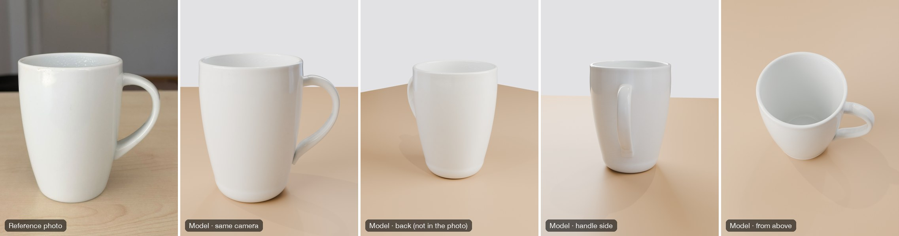
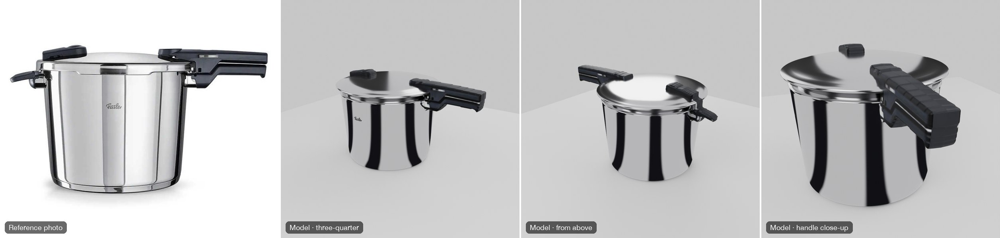

[English](README.md) | **Türkçe**

# reference-to-3d — bir Claude Code skill'i

Resimlerden Blender'da **resmin birebir aynısı** görünen 3B modeller üretir.

Bu skill, Claude'un göz kararı "benzer bir şey" modellemesi yerine resmin kendisini kullanmasını sağlar: biçim için
resmin çizgilerini, yüzey için piksellerini, sonucu kontrol etmek için de izlenimleri değil sayıları.

| Siz verirsiniz | Siz alırsınız |
|---|---|
| Bir turnaround sayfası ya da ayrı ön / yan / arka / üst görünümler (fotoğraf veya konsept çizim) | Çizgilere oturtulmuş, görünümlerin kendi pikselleriyle kaplanmış bir model |
| Tek bir yerden görülen bir iç mekân resmi (araç kokpiti, oyun kamerası) | O yerden piksel piksel aynı görünen bir iç mekân |
| Bir odanın tek fotoğrafı ya da render'ı | İçinde **dolaşılabilen** bir oda: kamera fotoğraftan çözülür, eşyalar 3B olur, görünmeyen taraflar fotoğrafın tekrar eden parçalarından kurulur |
| Boyutları bilinen bir ürünün sıradan bir fotoğrafı (dizüstü bilgisayar, telefon, sandalye) | Gerçek ölçülerinde kurulmuş ürün; fotoğraf her yüzeye düzeltilerek yerleştirilir |
| Dönel bir nesnenin tek fotoğrafı (tencere, şişe, vazo, kupa) | Eksen etrafında döndürülmüş profil, katı parçalar olarak yan saplar, bir kabın içi, her yanı saran fotoğraf; isterseniz fotoğrafın ışığı yerine gerçek malzemeler (çelik, plastik, porselen) |



*Solda referans: masadaki bir kupanın sıradan bir telefon fotoğrafı. Gerisi model, gerçek porselen olarak (Blender,
Cycles): önce fotoğrafın kendi kamerasından, sonra fotoğrafın hiç göstermediği yanlardan. Kamera ağzın ve tabanın
dış çizgilerinden çözüldü, profil eksen etrafında döndürüldü, kulp kendi dış çizgisi boyunca süpürüldü; fotoğrafın
kamerasından bakınca dış çizgi 0,982 (IoU), fotoğraf dokulu sürümün renkleri 1,4/255 farkla örtüşüyor. Nasıl
yapıldığı: [`examples/mug-revolved/`](examples/mug-revolved/).*



*Yandan çekilmiş tek bir ürün fotoğrafından: eksen etrafında döndürülmüş profil, katı parçalar olarak saplar, sonra
gerçek cilalı çelik ve plastik (Blender, Cycles). Arkadan ve üstten görünümler fotoğrafta yok (üreticinin ürün
fotoğrafı depoya konmadı). Nasıl yapıldığı:
[`examples/pressure-cooker-revolved/`](examples/pressure-cooker-revolved/).*

Sonuç **.blend** dosyası olarak kaydedilir (dokular dosyanın içinde). İsterseniz oyun motorları (Unity, Unreal,
Godot, three.js) için **glTF/GLB** olarak da dışa aktarılır; tekerlek ve kapı gibi hareketli parçalar ayrı mesh olur.

---

## 1. Gerekenler

| | |
|---|---|
| **Claude Code** | Terminal, masaüstü uygulaması ya da IDE eklentisi — [claude.com/claude-code](https://claude.com/claude-code) |
| **Blender** | 4.2 veya üstü (5.2 ile denendi) — [blender.org](https://www.blender.org/download/) |
| **uv** | Python betiklerini çalıştırır ve gereken paketleri (numpy, OpenCV…) kendisi kurar — [docs.astral.sh/uv](https://docs.astral.sh/uv/getting-started/installation/) |

uv'yi tek satırla kurun:

```bash
curl -LsSf https://astral.sh/uv/install.sh | sh
```

Windows'ta (PowerShell):

```powershell
powershell -ExecutionPolicy ByPass -c "irm https://astral.sh/uv/install.ps1 | iex"
```

Python paketlerini sizin kurmanız **gerekmez**; her betik kendi paketlerini belirtir, uv onları indirir.

## 2. Skill'i Claude Code'a yükleme

Skill, içinde bir `SKILL.md` dosyası bulunan bir klasörden ibarettir. Claude Code skill'leri iki yerde arar:

| Nereye | Nerede kullanılır | Ne zaman seçilir |
|---|---|---|
| `~/.claude/skills/reference-to-3d/` | **tüm** projelerinizde | her yerde kullanmak istiyorsanız (önerilen) |
| `<projeniz>/.claude/skills/reference-to-3d/` | yalnızca o projede | projenin deposu üzerinden ekiple paylaşmak istiyorsanız |

### Yol A — git ile (önerilen)

macOS / Linux:

```bash
git clone https://github.com/asimsinan/reference-to-3d.git ~/.claude/skills/reference-to-3d
```

Windows (PowerShell):

```powershell
git clone https://github.com/asimsinan/reference-to-3d.git "$env:USERPROFILE\.claude\skills\reference-to-3d"
```

### Yol B — git olmadan

1. GitHub'da **Code → Download ZIP**'e tıklayın.
2. ZIP'i açın.
3. Klasörün adını `reference-to-3d` yapın ve `~/.claude/skills/` içine taşıyın (Windows: `%USERPROFILE%\.claude\skills\`).

Hangi yolu seçerseniz seçin, sonuçta dosya şurada olmalı: `~/.claude/skills/reference-to-3d/SKILL.md`. `SKILL.md`
doğrudan bu klasörün içinde olmalı, bir klasör daha derinde değil.

### Yüklendiğini kontrol edin

**Yeni** bir Claude Code oturumu açın (skill'ler açılışta okunur) ve `/` yazın; listede `reference-to-3d` görünmeli.
Claude'a *"Hangi skill'lerin var?"* diye de sorabilirsiniz.

### Blender'ın yerini söyleyin (yalnızca varsayılan yerde değilse)

Skill, macOS'ta Blender'ı `/Applications/Blender.app` içinde bekler. Linux'ta (`blender` komutu PATH'te), Windows'ta
ya da Blender başka bir yerdeyse, sohbette bir kez söylemeniz yeter. Ya da projenizin `CLAUDE.md` dosyasına bir satır
ekleyin, örneğin:

```
Blender is at C:\Program Files\Blender Foundation\Blender 5.2\blender.exe
```

## 3. Kullanım

1. Resim(ler)i proje klasörünüze koyun ya da Claude Code sohbetine yapıştırın/sürükleyin.
2. Ne istediğinizi söyleyin. İki yolu var:
   - **Komutla:** `/reference-to-3d resimdeki odayı modelle`
   - **Ya da doğal bir dille isteyin.** İstek uyuyorsa Claude skill'i kendisi yükler, örneğin:
     - *"Bu dört görünümden aracın 3B modelini yap."*
     - *"Resimdeki odayı modelle, içinde dolaşabilmek istiyorum."*
     - *"Fotoğraftaki dizüstü bilgisayarı 3B yap, MacBook Pro 14."*
     - *"Ekteki resimdeki düdüklü tencereyi 3B modelle."*
     - *"Ekteki bardağı 3d modelle, sonra gerçek porselen yap."*
     - *"Unity için GLB olarak dışa aktar, tekerlekler ayrı parça olsun."*

### Claude ne yapar?

1. **Resmi okur**: görünümleri adlandırır, kamerayı çözer, gerçek bir ölçü arar (size sorabilir, örneğin "kapı kaç metre?").
2. **Biçimi kurar**: çizgilere oturtarak ya da çözülen kamera üzerinden ölçerek.
3. **Resmin kendi piksellerini modelin üzerine yerleştirir.**
4. Sonucu görünüm görünüm resimle **ölçer** (çizgi örtüşmesi ve renk farkı, sayıyla) ve size **yan yana bir
   karşılaştırma** gösterir (solda resim, sağda model).
5. Gösterdiğiniz farkları her seferinde bir görünüm üzerinden **düzeltir**.
6. `.blend` dosyasını **kaydeder** (bakılmaya hazır açılır); isterseniz GLB de verir.

### İyi sonuç için ipuçları

- Biliyorsanız **gerçek bir ölçü verin** (kapı 2.0 m, minibüs 1.9 m yüksekliğinde). Geri kalan her şey ondan çıkar.
- **Modelin nerede kullanılacağını söyleyin**: tek bir render, oyun motoru, ya da içinde dolaşmak.
- **Karşılaştırma görüntülerine bakın ve neyin farklı olduğunu söyleyin**; "benzer"den "birebir"e böyle gidilir.
- **Görüntü üretme kredisi** (hiçbir resmin göstermediği tarafları doldurmak için) yalnızca siz onaylarsanız harcanır.
  Önce her zaman ücretsiz yol önerilir: o tarafları resmin kendi tekrar eden parçalarından kurmak.

### Akılda tutulacak sınırlar

- Resmin ışığı ve yansımaları dokuya işlenir; sahnenizin ışıklarıyla değişmez.
- Hiçbir resmin göstermediği yüzeyler gerçeğin kendisi değil, makul tahminlerdir; Claude bunların hangileri olduğunu söyler.
- Bir odanın tek resminden yapılan model, o resmin kamerasından birebirdir. İçinde dolaşınca yakından bakıldığında
  tekrar eden parçalar fark edilir (aynı pencere bölmesi, aynı makine).

## 4. İçinde ne var?

```
reference-to-3d/
├── SKILL.md                     Claude'un izlediği talimatlar (nasıl çalıştığını okumak isterseniz buradan başlayın)
├── scripts/                     Claude'un çalıştırdığı araçlar (her birinin kullanımı kendi başlığında)
│   ├── split_sheet.py           turnaround sayfası → adlandırılmış görünümler ve maskeler
│   ├── hull.py, loft.py         çizgilerden biçim (her nesne / uzun nesneler)
│   ├── textures.py, project.py  görünümlerin piksellerini modele yerleştirir; render, .blend, GLB (Blender)
│   ├── compare.py               görünüm başına çizgi örtüşmesi ve renk farkı, karşılaştırma görüntüleri
│   ├── solve_camera_vp.py       bir oda fotoğrafının kamerasını çizgilerinden çözer (odak, eğim, ölçek)
│   ├── rectify_plane.py         odanın bir duvarını/zeminini fotoğraftan düz görünecek şekilde çıkarır
│   └── shot_ui.py               .blend dosyasını açıldığı haliyle ekran görüntüsüne alır
├── docs/showcase/               bu README'deki görseller
├── references/                  Claude'un gerektiğinde okuduğu ayrıntılı rehberler
│   ├── single-view-interior.md  tek resimden iç mekân; dolaşılabilir odalar
│   ├── single-photo-object.md   boyutu bilinen bir ürünün tek fotoğrafı
│   ├── single-photo-revolved.md dönel bir nesnenin tek fotoğrafı (tencere, şişe, vazo, kupa)
│   ├── game-export.md           oyun motorları için adlar, pivotlar ve ayarlar
│   └── pitfalls.md              daha önce neyin, neden yanlış gittiği
└── examples/                    betikleriyle birlikte dört eksiksiz örnek
    ├── laptop-single-photo/     tek fotoğraftan bir dizüstü bilgisayar
    ├── pressure-cooker-revolved/ tek ürün fotoğrafından bir düdüklü tencere
    ├── mug-revolved/            tek telefon fotoğrafından porselen bir kupa
    └── laundromat-room/         tek render'dan dolaşılabilir bir çamaşırhane
```

`scripts/` ya da `examples/` içindeki hiçbir şeyi sizin çalıştırmanız gerekmez; bunları Claude çalıştırır. İsterseniz
her örneğin `README.md` dosyası komutlarını sırasıyla listeler.

## 5. Güncelleme

git ile kurduysanız:

```bash
cd ~/.claude/skills/reference-to-3d && git pull
```

Ardından yeni bir Claude Code oturumu açın.

## 6. Sorun giderme

| Sorun | Çözüm |
|---|---|
| `/reference-to-3d` listede görünmüyor | `SKILL.md` dosyasının `~/.claude/skills/reference-to-3d/SKILL.md` yolunda olduğunu kontrol edin, sonra yeni bir oturum açın. |
| "Blender bulunamadı" | Claude'a Blender'ın tam yolunu söyleyin (2. bölüm). |
| `uv: command not found` | uv'yi kurun (1. bölüm) ve yeni bir terminal açın. |
| İlk çalıştırma yavaş | uv paketleri (OpenCV, numpy) bir kez indiriyor; sonraki çalıştırmalar hızlıdır. |
| .blend dosyası gri açılıyor | 3B görünümün sağ üstündeki üçüncü küre simgesine, yani **Material Preview**'a geçin. |
